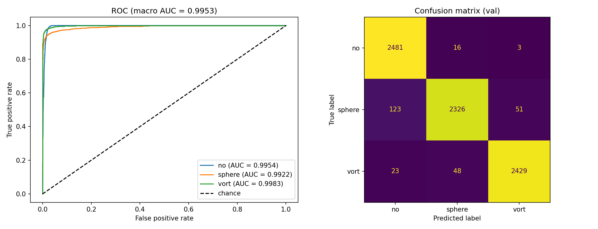

# DeepLense Test Tasks 2026
ML4SCI | DeepLense evaluation tests

## Overview
My solution for Common Test I (multi-class classification) of the DeepLense evaluation tests.

| Task | Model | Result |
|---|---|---|
| 3-class classification (no / sphere / vort) | ResNet18 | Val acc 96.48%, macro AUC 0.9953 |

## Repository Structure
```
DeepLense-Test-Tasks-2026/
├── common_test_1/
│   ├── common_test_1.ipynb          # notebook
│   ├── resnet18_common_test1.pth    # saved weights
│   └── roc_confusion.png            # ROC curves + confusion matrix
├── requirements.txt                 # libraries used   
├── .gitignore                    
└── README.md
```

## Common Test I: Multi-Class Classification

### Dataset
- Three classes: no substructure (no), sphere substructure (sphere), vortex substructure (vort)
- `.npy` files, shape (1, 150, 150)
- 30,000 train / 7,500 val (2,500 per class)
- I used the given train/val folders as they are. The test doc mentions a 90:10 split, I didn't redo it.

### Preprocessing (train only augmentation)
- Resize to 256x256
- Normalised with my own mean/std (0.0617 / 0.1171), taken from every 50th train image
- Random horizontal and vertical flip (p=0.5)
- Random rotation (20 degrees)

### Model
ResNet18 pretrained on ImageNet. `conv1` is replaced with a 1-channel conv and `fc` with a 3-class layer.

- Loss: CrossEntropyLoss
- Optimizer: Adam (lr=1e-4, weight decay=1e-4)
- Scheduler: cosine decay from 1e-4 to 1e-6 (stepped every batch)
- Epochs: 15, batch size 32
- Platform: Google Colab (T4), dataset zip on my Drive

### Training Curves
| Epoch | Train Loss | Train Acc | Val Loss | Val Acc |
|---|---|---|---|---|
| 1 | 0.8293 | 58.50% | 0.5210 | 77.65% |
| 5 | 0.2380 | 91.38% | 0.1954 | 92.71% |
| 10 | 0.1436 | 95.04% | 0.1252 | 95.65% |
| 15 | 0.0989 | 96.63% | 0.1041 | 96.48% |

### Results
- Val Accuracy: 96.48%
- Macro AUC: 0.9953

| Class | AUC | Precision | Recall |
|---|---|---|---|
| no | 0.9954 | 0.94 | 0.99 |
| sphere | 0.9922 | 0.97 | 0.93 |
| vort | 0.9983 | 0.98 | 0.97 |



Sphere is the weakest class. 123 sphere images were predicted as "no" and 51 as "vort".

### Notes
- Val was used for monitoring and for the final numbers. There is no separate test set.
- Results change slightly between runs. The same code gave 96.28%, 96.43% and 96.48% in three runs.
- Before this I tried no normalisation with lr 1e-3 (about 92-94%, overfit) and a manual lr drop without a scheduler (96.28%). Those notebooks are not in this repo.